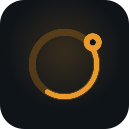
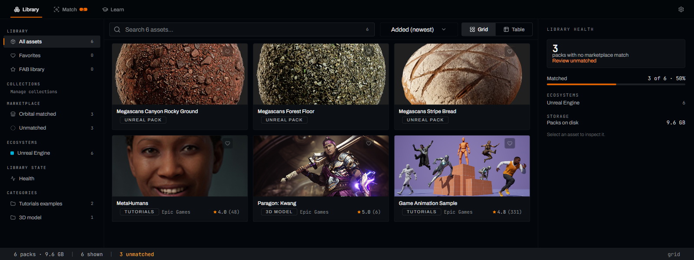
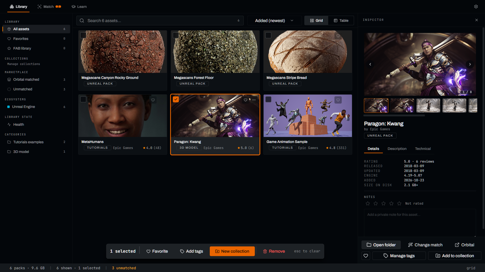

<p align="center">
  
</p>

<h1 align="center">Omnidex</h1>

<p align="center">
  <b>Every asset pack and course you own, in one searchable library that your AI agents can read too.</b><br>
  For Unreal Engine, Fab, Blender, Houdini and the rest of your toolkit. Local, free and open source.
</p>

<p align="center">
  <a href="https://github.com/Umbra-Lab/Omnidex/releases">Download</a> ·
  <a href="docs/devbook/src/SUMMARY.md">Developer handbook</a> ·
  <a href="AGENTS.md">For AI agents</a> ·
  <a href="CONTRIBUTING.md">Contributing</a> ·
  <a href="https://github.com/sponsors/figgiee">Sponsor</a>
</p>

<p align="center">
  
</p>

## Why Omnidex exists

If you make games or 3D work, you collect tools fast: Fab and Unreal Marketplace packs, Blender add-ons, Houdini digital assets, Substance materials, ZBrush brushes, and the video courses that taught you to use them. They pile up across drives as folders with names you no longer remember, and the only search is your memory. You rebuy things you already own and rewatch an hour of course to find one minute.

Omnidex turns all of it into one library on your own machine. It is built for three readers: you, browsing and searching; your courses, made searchable down to the sentence; and the AI agents you work with, which can query what you own through a standard protocol.

## What you can do with it

**Find anything you own, across every tool.** Point Omnidex at your folders. It recognizes Unreal, Blender, ZBrush, Houdini, Unity, Maya, 3ds Max, Cinema 4D, Substance, After Effects and Marvelous Designer content, plus generic 3D and audio packs, and indexes them into one full-text search with filters and collections.

**See Unreal assets without opening the engine.** Omnidex reads thumbnails straight out of `.uasset` files with its own Rust parser, so a pack shows real previews before you import it.

**Know what you have before you buy it again.** Packs are matched against the Orbital Market catalog and your own Fab library, filling in seller, category, description and gallery images.

<p align="center">
  
</p>

**Learn from the courses you already paid for.** Course folders become a player with resume and notes. Subtitles are indexed as timestamped transcripts, so searching "niagara ribbon" lands on the exact moment an instructor said it.

**Give your AI agents your library.** A built-in [MCP server](docs/devbook/src/subsystems/oracle-mcp.md) lets Claude Code, Cursor or any MCP client search your assets, lessons and transcripts while they work, and cite a course at a timestamp in place of generic training data.

**Ask questions in the app.** The Ask panel answers questions about your library and courses through a local model server you run, or the Claude CLI.

**Keep it private.** Everything lives in a local SQLite database. There is no account and no telemetry; [`PRIVACY.md`](PRIVACY.md) lists exactly what the optional enrichment sends and where.

## Install

Download the installer for your platform from the [Releases page](https://github.com/Umbra-Lab/Omnidex/releases):

| Platform | File |
|---|---|
| Windows 10/11 (x64) | `Omnidex-Setup-<version>.exe` |
| macOS (Apple silicon) | `Omnidex-<version>-arm64.dmg` |

The builds are not code-signed yet. On Windows, choose **More info → Run anyway** at the SmartScreen prompt. On macOS, right-click the app and choose **Open** the first time.

Open Omnidex, add the folder that holds your asset packs, and the first scan starts. Add more folders under **Settings → Folders**.

## Build from source

You need Node 24 (`.nvmrc`), pnpm 11, and Rust 1.88 or newer. On macOS, also the Xcode Command Line Tools; on Windows, the MSVC build tools.

```bash
git clone https://github.com/Umbra-Lab/Omnidex.git
cd Omnidex
pnpm install
pnpm dev
```

`pnpm install` builds the Rust addon, downloads Electron and applies the bundled patches, so no other setup is needed. To build an installer, run `pnpm package` on Windows or `pnpm package:mac` on macOS; output lands in `dist-installer/`. The [set-up guide](docs/devbook/src/start/set-up.md) and [troubleshooting page](docs/devbook/src/troubleshooting.md) cover everything else.

## Work on it with an AI agent

The repository is set up for coding agents. [`AGENTS.md`](AGENTS.md) holds the commands, the definition of done, and the rules that are not obvious from the code. Claude Code, Codex, Cursor, Copilot and Gemini CLI all pick it up automatically.

A good first prompt:

> Read AGENTS.md, then fix issue #N. Run the checks it lists and show me the output before you open a pull request.

Agent-written pull requests are welcome when a person has reviewed them, can explain every change, and discloses the tool used. See the [AI-assisted contributions policy](CONTRIBUTING.md#ai-assisted-contributions).

## How it fits together

An Electron main process owns the SQLite database, the file scanner and every network call. The React renderer reads from it over tRPC. A Rust addon parses `.uasset` headers and extracts thumbnails in disposable worker processes, so a malformed file cannot crash the app. The [architecture page](docs/devbook/src/orientation/architecture.md) has the full picture.

## Third-party services

Omnidex is an unofficial community tool. The screenshots above show Epic Games' own Paragon, Game Animation Sample and MetaHuman samples and Quixel Megascans assets, indexed from a local Epic launcher download. It is not affiliated with, endorsed by, or supported by Epic Games, Fab, Unreal Engine or Orbital Market. Fab library sync signs in to your own Epic account and reads only your own library. Orbital enrichment reads public product listings at a throttled rate. Neither service offers a public API, so either feature can stop working without notice.

## Support the project

Omnidex is built and maintained in spare time. If it saves you time, [sponsoring on GitHub](https://github.com/sponsors/figgiee) keeps it going. Bug reports and ideas go in [Issues](https://github.com/Umbra-Lab/Omnidex/issues). Report security problems privately as described in [`SECURITY.md`](SECURITY.md).

## License

MIT, see [`LICENSE`](LICENSE). Bundled fonts (Archivo, JetBrains Mono) are under the SIL Open Font License, and every bundled dependency's license is collected in [`THIRD-PARTY-NOTICES.md`](THIRD-PARTY-NOTICES.md). Unreal Engine and Fab are trademarks of Epic Games, Inc.
