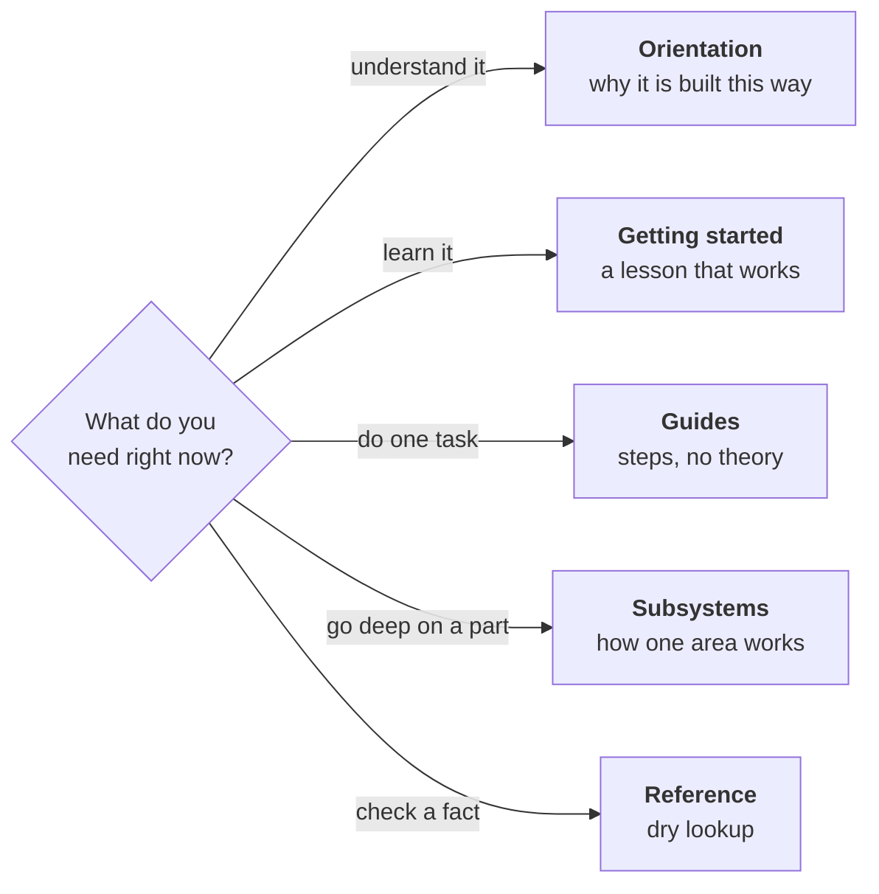

# Omnidex Devbook

Omnidex is a local-first desktop application that indexes large media libraries — Unreal Engine asset packs and video course collections — into a searchable catalogue with thumbnails, tags, collections, full-text transcript search, and marketplace metadata. It runs entirely on your machine. No account, no server, no upload.

This book is for people who work on Omnidex. It explains what the system is, how it is built, how to change it, and where to look things up.

## Where to start

| You want to | Read |
|---|---|
| Understand what this thing is | [What Omnidex is](orientation/what-omnidex-is.md) |
| See how the pieces fit | [How it works](orientation/architecture.md) |
| Get it running | [Set up a development environment](start/set-up.md) |
| Change something | [Guides](guides/add-a-trpc-procedure.md) |
| Look up a command or a table | [Reference](reference/commands.md) |
| Write a page for this book | [Writing for this devbook](standards/documentation.md) |

## How this book is organised

Every page belongs to exactly one of five sections, and each section answers a different kind of question. This is deliberate: a page that tries to teach a newcomer *and* serve as an exhaustive lookup does neither job well.



- **Orientation** explains the system and the reasoning behind it. Read it once, in order.
- **Getting started** walks you from a clean checkout to a working, populated app. Follow it exactly; it is meant to succeed on the first try.
- **Guides** each accomplish one real task and assume you already have the basics.
- **Subsystems** are deep dives into a single area, for when you are about to change it.
- **Reference** is exhaustive and boring on purpose. Facts, tables, no narrative.
- **Standards** define how we write code, tests, and this book.

```admonish tip title="Version drift"
Counts and versions in this book (procedure names, migration numbers, table lists) were verified against the repository at the time of writing and will drift. Each page names the file that is the source of truth. When they disagree, the code is right and the page is a bug — fix it.
```

## Build this book

```bash
cd docs/devbook && mdbook serve --open
```

You need `mdbook`, `mdbook-mermaid`, and `mdbook-admonish` on your `PATH`. See [Writing for this devbook](standards/documentation.md) for the toolchain and the writing rules.
