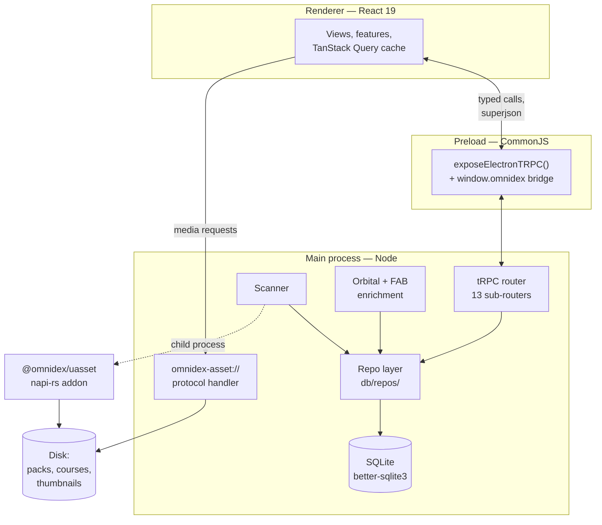

# How it works

Omnidex is an Electron application with three processes and one native addon. The main process owns everything stateful — the database, the filesystem, the network. The renderer owns the UI and reaches the main process through one typed channel.

## The processes



- **Main** (`electron/main/`, TypeScript, built to `out/main/index.mjs`) holds the database connection, runs scans and enrichment, registers the custom protocol, and dispatches CLI flags.
- **Preload** (`electron/preload/index.ts`, emitted as `.cjs`) calls `exposeElectronTRPC()` before exposing the legacy `window.omnidex` bridge. Both surfaces coexist; only tRPC is on the hot path.
- **Renderer** (`renderer-react/`, React 19, Vite with the React Compiler enabled) renders the UI and holds no authoritative state.

## The one data path

The renderer's only live data path is tRPC over `electron-trpc`, serialized with superjson. The root router (`electron/main/trpc/router.ts`) mounts thirteen sub-routers:

```
assets · scanLocations · collections · courses · notes · settings
scanner · orbital · fab · libraryHealth · progress · ask · updates
```

Every one of them calls into the shared repo layer at `electron/main/db/repos/`. No router touches SQL directly, and no repo function knows it is being called over IPC. That separation is what lets the CLI data operations reuse the exact code the UI calls.

Types flow end to end: the renderer imports only the `AppRouter` *type*, so no server code is bundled into the client, and a renamed procedure is a compile error rather than a runtime 404.

```admonish warning title="The superjson patch is load-bearing"
`patches/electron-trpc@1.0.0-alpha.0.patch` wires superjson into electron-trpc's transformer. Without it, every tRPC call fails with `Cannot read properties of undefined (reading 'serialize')`. `pnpm install` applies it via `postinstall`; run `pnpm apply-patches` if calls start failing after a dependency change.
```

## A second, vestigial surface

A legacy `ipcRenderer.invoke('omnidex:*')` surface still exists in the preload, backed by handlers in `electron/main/ipc/`. The React renderer does not use the `omnidex.db.*` or `omnidex.scanner.*` bridges.

When adding renderer-facing data access, extend the tRPC router. Do not add `ipcRenderer.invoke` calls to renderer code. See [IPC and the tRPC layer](../subsystems/ipc.md) for what is still genuinely needed there (shell operations, dialogs, credentials).

## Serving local media

The renderer cannot read a file path. `omnidex-asset://<encoded-absolute-path>` is a privileged scheme registered in `electron/main/index.ts` that streams local files — thumbnails, video, audio, documents — to the renderer.

The handler supports HTTP range requests and answers with `206 Partial Content` plus `Content-Range`, and advertises `Accept-Ranges: bytes` on every response. This is not an optimization. Chromium's media pipeline will not let you seek in a video served without range support, and playback position cannot be restored on resume.

## How long work runs

Scanning and enrichment are long, failure-prone, and must not block the UI thread or die halfway.

- A scan runs in the main process and streams progress over the `progress.onProgress` tRPC subscription, fed by a shared `progressBus`.
- The renderer subscribes through the `useActionProgress` hook and can cancel via `scanner.cancel`.
- Thumbnail extraction runs **after** the scan returns, in disposable child processes, because the native parser can abort the process on a malformed file. See [The uasset addon](../subsystems/native-uasset.md).

The same services back both the UI buttons and the CLI flags. `pnpm refresh-scans` and the Command Palette's **Refresh library** command call the same `refreshAllScans`.

## Native modules

Three native dependencies are rebuilt against Electron's ABI after install:

| Module | Purpose |
|---|---|
| `better-sqlite3` | Synchronous SQLite with FTS5 |
| `keytar` | OS credential storage for Epic tokens |
| `@omnidex/uasset` | Local napi-rs crate at `native/uasset/`; parses `.uasset`/`.umap` and extracts thumbnails |

`@omnidex/uasset` is the only Rust in the repository. There is no Tauri, no SQLx, and no application-level Rust backend.

```admonish tip title="Bindings error after an install"
`Could not locate the bindings file` means a plain `pnpm install --force` reset `better-sqlite3` to the system Node ABI. Run `pnpm run rebuild`.
```

## Next steps

- [The data model](data-model.md) — what the tables mean and how they relate
- [The scanner](../subsystems/scanner.md) — the pipeline that fills them
- [Set up a development environment](../start/set-up.md) — get it running
