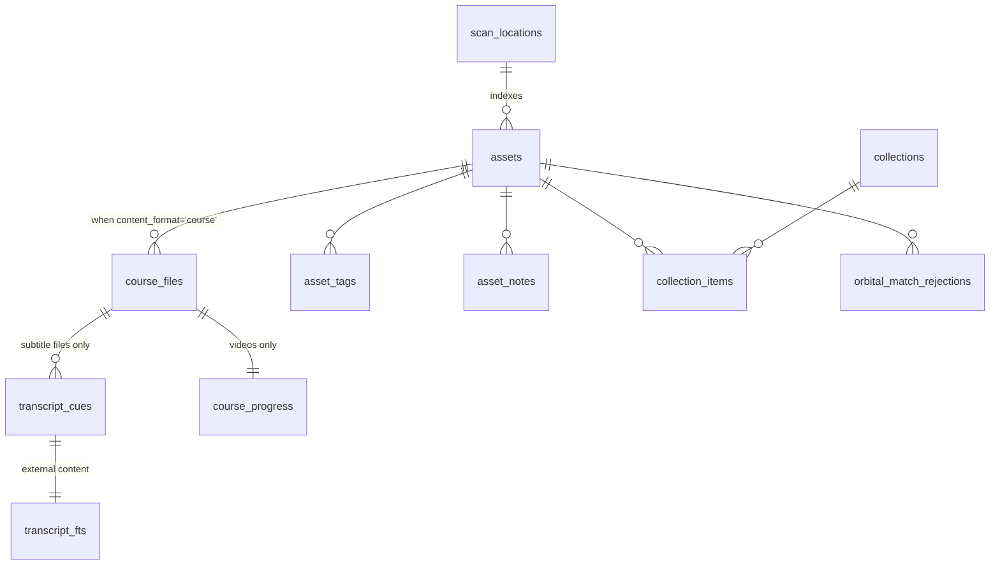

# The data model

Everything hangs off two tables. `scan_locations` says where to look; `assets` is one row per thing found. Every other table decorates an asset or a file inside one.

## The core shape



## assets

One row per pack or course, keyed by `file_path` (unique). The column that decides everything downstream is **`content_format`**:

| `content_format` | Meaning | Where it shows |
|---|---|---|
| `NULL` | An asset pack | Assets view |
| `'course'` | A video course | Learn view |

It comes from the **scan location**, not from inspecting the folder. A location is declared to hold courses or packs, and every top-level folder under it is treated that way. This is why a course root must point at the discipline folder, not its parent — see [Add a scan location](../guides/run-a-data-operation.md#add-a-scan-location).

The table is wide, and its columns fall into groups:

| Group | Examples | Written by |
|---|---|---|
| Identity | `name`, `file_path`, `asset_type`, `file_size` | Scanner |
| Curation | `is_favorite`, `display_title`, `description` | The user |
| Thumbnail | `thumbnail_path`, `has_local_thumbnail` | Thumbnail extraction |
| Marketplace | `orbital_title`, `orbital_seller_name`, `orbital_price`, `orbital_rating_average`, `orbital_categories` | Enrichment |
| Lifecycle | `missing_since`, `first_indexed_timestamp` | Scanner reconciliation |

```admonish warning title="Curation must survive a re-scan"
A re-scan upserts on `file_path` and prunes rows whose folder vanished. Favorites, tags, notes, collection membership, and playback position must not be lost by that pass. `electron/main/scanner/__tests__/prune-preserves-curation.test.ts` exists to keep it that way.
```

## Courses

A course asset has a **manifest**: one `course_files` row per file that matters, with `kind` in `video`, `subtitle`, or `doc`.

```
assets (content_format='course')
  └── course_files          rel_path, abs_path, kind, chapter, order_index, duration_seconds
        ├── course_progress     position_seconds, completed      (videos)
        └── transcript_cues     start_ms, text                   (subtitles)
```

`chapter` and `order_index` are derived from the folder layout and the author's numbering, which is why lessons sort `1, 2, 10` and not `1, 10, 2`.

```admonish danger title="course_files ids are not stable"
Re-scanning a course deletes and reinserts its `course_files` rows, which reassigns their `AUTOINCREMENT` ids. Anything keyed to a file id must either cascade or be re-derived. `course_progress` survives because the scanner explicitly carries it across by `rel_path`; `transcript_cues` survives because the scanner re-parses the `.srt` sidecars on disk, which are the real source of truth.

This is not theoretical. Before the cascade existed, every scan stranded the previous scan's cues — 2,794,345 of 4,648,463 rows (60%) belonged to file ids that no longer existed.
```

## Transcripts

`transcript_cues` is a real table with an index on `(file_id, start_ms)`. `transcript_fts` is an FTS5 **external-content** index over it, kept in sync by triggers.

```sql
CREATE VIRTUAL TABLE transcript_fts USING fts5 (
  text, content = 'transcript_cues', content_rowid = 'id',
  tokenize = 'porter unicode61'
);
```

This shape matters for two reasons:

- A virtual table cannot carry a foreign key. Putting the cues in a real table lets `ON DELETE CASCADE` reclaim them when a lesson is pruned.
- FTS5 columns marked `UNINDEXED` are not indexed for anything but `MATCH`. When `file_id` lived there, every lookup by file scanned the whole corpus — about 1.1 seconds per call at 4.6 million cues. It is now a B-tree seek.

```admonish note title="Cues key to the subtitle file, not the video"
`transcript_cues.file_id` points at the `course_files` row for the `.srt`, not the `.mp4`. Pairing the two is a stem match — see [Learn: courses and transcripts](../subsystems/learn.md).
```

Search runs through the FTS index and joins back:

```sql
SELECT c.text, c.file_id, c.start_ms
FROM transcript_fts t
JOIN transcript_cues c ON c.id = t.rowid
WHERE transcript_fts MATCH ?
ORDER BY rank
```

## Full-text search on assets

`assets_fts` indexes pack names and marketplace titles with BM25 weighting that favours the name. It is a separate index with a separate lifecycle from `transcript_fts`; do not assume changes to one apply to the other.

## Legacy tables

The database carries tables from earlier iterations that nothing writes any more, including `_sqlx_migrations` (from the pre-Electron Tauri build), `assets_v2`, `batch_state`, and several `marketplace_*` tables superseded by the `orbital_*` set.

Migration `20260614000000_drop_dead_tables` removed one batch. The rest are inert. Do not build on them, and check `electron/main/db/repos/` for what is actually read before assuming a table is live.

## Next steps

- [Database schema](../reference/schema.md) — the exhaustive table and column list
- [The database](../subsystems/database.md) — migrations, the migrator, and transactions
- [The scanner](../subsystems/scanner.md) — how rows get here
