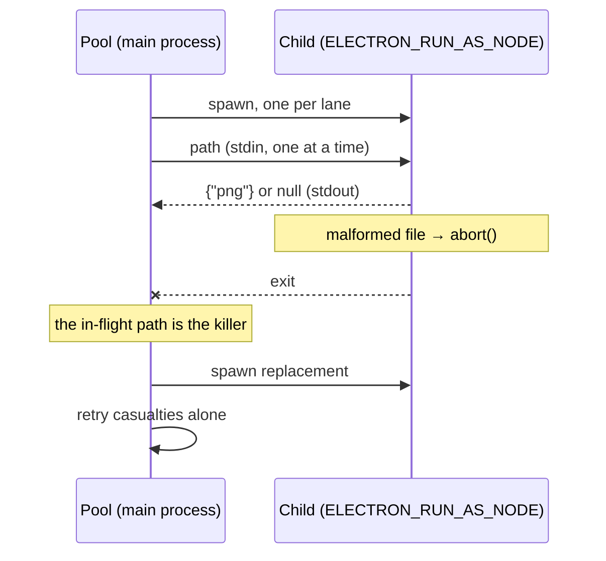

# The uasset addon

`@omnidex/uasset` is a napi-rs crate at `native/uasset/`. It parses Unreal `.uasset` and `.umap` files and extracts the thumbnail Unreal embeds in them, resized and re-encoded as PNG.

It is the only Rust in the repository.

## The API

| Export | Purpose |
|---|---|
| `parseUasset(path)` | Header metadata, including whether a thumbnail is present |
| `extractThumbnail(path, outDir, size)` | Writes a PNG and returns its path, or `null` |

Both are async at the JS boundary and synchronous inside.

## Building

```bash
pnpm build:uasset
```

The built `.node` ships via the package `files` manifest.

`pnpm ensure:uasset` (`scripts/ensure-uasset.mjs`) runs in `postinstall` and before every app launch. If no binary exists, it copies one from another worktree whose `Cargo.toml`, `Cargo.lock`, `build.rs`, `index.js` and `src/` are byte-identical and whose binary is newer than them, or builds one with cargo. Set `OMNIDEX_UASSET_NO_COPY=1` to force the build. It warns when an existing binary is older than the sources, and never rebuilds it on its own: run `pnpm build:uasset`.

## Why extraction runs in a child process

This is the important part of the page.

The upstream `uasset` 0.6 crate sizes its allocations from counts it reads out of the package header. A malformed header therefore asks for an absurd amount of memory. Measured on a real library, nine files between 687 and 5,516 bytes each caused a **1,679 MB** allocation — roughly 400,000× amplification.

A failed allocation in Rust calls `abort()`. That is not an exception. It cannot be caught by `try`/`catch`, and it is not intercepted by a `Promise.race` timeout, both of which the code previously had. The process dies.

The observed failure was a 20-location scan dying at location 4:

```
memory allocation of 5857542141 bytes failed
[ELIFECYCLE] Command failed with exit code 3221226505
```

The damage was out of proportion to the job. Thumbnail extraction is a background, best-effort task the catalogue does not need — and it took down the entire indexing run, skipping sixteen locations and the reconciliation prune.

```admonish danger title="Never call the extractor in-process"
`extractThumbnail` must be called through `extractThumbnailsIsolated` (`electron/main/scanner/thumbnail-pool.ts`). Calling it directly on a scan path reintroduces a whole-process abort on malformed input, and no amount of error handling around the call site will help.
```

## How the isolation works



A worker owns one child and feeds it a single path at a time. If the child dies, the path in flight is by definition what it was holding. A hang is folded into the same route by killing the child on timeout, so there is one recovery path rather than two.

## Why casualties are retried alone

Four child processes demand the same aggregate memory four in-process calls did. Isolation converts a fatal abort into a recoverable one; it does not reduce the pressure. So the child whose allocation fails is **not necessarily** the child holding the bad file.

The evidence is unusually clean: a sequential sweep of the whole library crashes zero times, while the same files at four-wide bring the process down. 1.68 GB × 4 ≈ 6.5 GB, which brackets the observed 5.86 GB failure.

Crashed paths are therefore swept again at concurrency 1, and only a file that dies with the field to itself is reported as malformed. Innocent files get their thumbnail back instead of a permanent diagnostic entry.

```admonish warning title="A sequential harness cannot reproduce this bug"
Two separate attempts to name the offending file ran sequentially and both reported "0 of ~2,700 files abort the process". That is the expected result of the wrong experiment, not evidence the bug is gone. Reproducing it requires concurrency.
```

## Verifying the isolation still extracts

The pool's unit tests drive a stub child. That proves the crash-recovery protocol but says nothing about whether the real addon still produces images through it — and a native call that silently returns `null` for everything looks identical to a library of unextractable files.

```bash
POOL_LIVE_LIST=/path/to/uassets.json pnpm exec vitest run electron/main/scanner/__tests__/pool-live.local.test.ts
```

The file is a JSON array of `.uasset` paths. The test skips without the variable, so CI is unaffected.

## Reading a failure

| Message | Meaning |
|---|---|
| `invalid thumbnail dimensions: 0x0` | Normal. BuiltData maps and blueprint wrappers carry no preview. |
| `compressed thumbnail too large` | The crate's own guard fired; the file is malformed but handled. |
| `could not decode thumbnail` | A preview exists in a format the decoder does not recognise. |
| Child exit with no message | An allocation abort. The pool records it and moves on. |

The guards in `native/uasset/src/thumbnail.rs` (`MAX_COMPRESSED_SIZE`, dimension checks) sit **downstream** of the allocation that actually fails, which is inside `AssetHeader::new` in the upstream crate. They cannot prevent it. Process isolation is the only mitigation available without forking the crate.

## Next steps

- [The scanner](scanner.md) — where the pool is called from
- [Testing](../standards/testing.md) — the stub-vs-live distinction generalised
