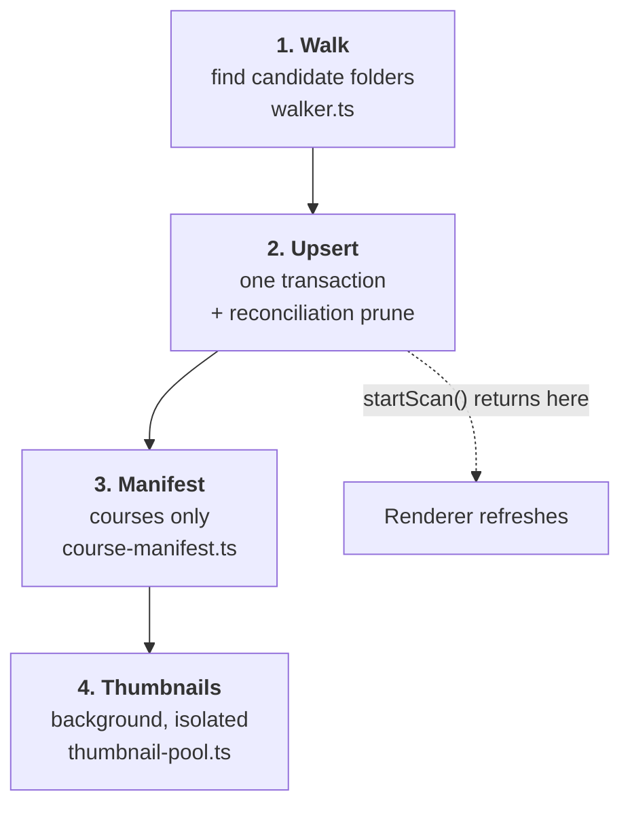

# The scanner

The scanner turns a folder on disk into rows in the database. It is the longest-running and most failure-prone part of Omnidex, and its design is mostly a response to that.

Entry point: `startScan(locationId)` in `electron/main/scanner/pipeline.ts`. The multi-location sweep is `refreshAllScans` in `refresh-all.ts`, which both the CLI and the UI call.

## The phases



Phases 1–3 are the scan. Phase 4 runs after `startScan` returns, because it is slow and optional and the catalogue is useful without it.

## Phase 1: the walk

`walkRootWithDiagnostics(root, { flat })` returns folders plus a list of diagnostics explaining anything it skipped.

Two modes:

- **Pack mode** (default) descends looking for asset packs. A folder is a pack if it contains `.uasset`/`.umap` files directly, has a `Content/` directory, or matches Unreal's interior folder naming.
- **Flat mode** (`flat: true`, used for every location with a `content_format`) treats each top-level folder as one item and does not descend looking for packs. Without it, a course shipping a sample Unreal project would register that project as a separate pack.

Packs above `MAX_FILES_PER_PACK` (5000, `walker.ts`) get `sizeIsPartial` set rather than being fully measured. Walking a 200,000-file pack to sum its bytes is not worth the minutes it costs.

Every skip is recorded as a `scan_diagnostics` row, which is what the Library Health view reads. A folder that silently does not appear in the library is a bug; a folder that appears in diagnostics with a reason is working as intended.

## Phase 2: upsert and prune

The per-folder upsert loop and the reconciliation prune run inside **one** transaction, using raw `BEGIN`/`COMMIT`/`ROLLBACK` rather than `db.transaction()` so the same path works under the `node:sqlite` engine the tests use.

The prune deletes rows for packs that vanished from disk. It is only safe on a **complete** walk:

```admonish danger title="An aborted scan must not prune"
An aborted scan has a partial `seenPaths` set, so pruning against it would delete live rows. The prune is skipped when `controller.signal.aborted` is set.

This is also why a crash mid-scan is worse than a clean cancel: a process that dies never reaches the prune *or* the abort check, and a bad scan's rows survive.
```

## Phase 3: course manifests

For course locations only. `buildCourseManifest` walks the course to `MAX_DEPTH` 6 (`course-manifest.ts`), classifies files as `video`, `subtitle`, or `doc`, derives `chapter` and `order_index` from the layout, and reads each video's duration from its container header.

Then subtitles are parsed and indexed. This happens **after** the manifest commits, because cues attach to `course_files` ids that must exist first.

```admonish note title="Subtitles are re-parsed every scan"
`replaceTranscript` is called for every subtitle file on every scan. That looks wasteful, but it is what makes the cue index self-healing: the `.srt` files on disk are the source of truth, so a cue table damaged by an interrupted scan repairs itself on the next full one.
```

## Phase 4: thumbnails

Runs after `startScan` returns, fire-and-forget, with the promise explicitly handled so a rejection cannot surface as an `unhandledRejection`.

Source selection (`thumbnail-finder.ts`) is breadth-first to depth 4, visiting at most 200 directories, skipping `Intermediate`, `DerivedDataCache`, `Build`, `Saved`, `Binaries`, `node_modules`, and `.git`. The first `.uasset` found wins. Failing that, it picks a hero image: shallowest first, largest breaking the tie, ignoring anything under 4 KB as probably a UI icon.

Only `.uasset` sources reach the native extractor, and they reach it **in a child process**. That is not a performance choice — see [The uasset addon](native-uasset.md) for why an in-process call could kill the entire scan.

## Progress and cancellation

A scan publishes to a shared `progressBus`, which the `progress.onProgress` tRPC subscription streams to the renderer. `ScanProgressPanel.tsx` renders it via the `useActionProgress` hook and cancels through `scanner.cancel`.

A legacy `webContents.send('scan-progress')` channel still fires and has no renderer consumer. It is kept only for an Electron IPC smoke test.

```admonish warning title="Do not emit progress per folder"
The main loop is deliberately silent during the foreground scan. Emitting per folder caused cascading effect loops in the renderer (`refreshService → fetchAll → store update → effect → …`) that crashed the window on fast scans. Only the terminal event is emitted.
```

## Where things go wrong

| Symptom | Likely cause |
|---|---|
| A folder is missing from the library | Check `scan_diagnostics` for that path before assuming a walker bug |
| Nine "courses" named after disciplines | The course location points at a category folder, not a course folder |
| A course registers its sample project as a pack | Flat mode is off — the location has no `content_format` |
| Rows survive that should have been pruned | The scan aborted or crashed before the prune |
| Thumbnails all fail on a location | Often correct: `invalid thumbnail dimensions: 0x0` is what a BuiltData map or blueprint wrapper returns |

## Key files

| File | Role |
|---|---|
| `pipeline.ts` | `startScan`, the four phases, thumbnail orchestration |
| `refresh-all.ts` | Multi-location sweep for CLI and tRPC |
| `walker.ts` | Folder detection and diagnostics |
| `course-manifest.ts` | Lesson manifest, chapter/order derivation, cue parsing |
| `thumbnail-finder.ts` | Source selection |
| `thumbnail-pool.ts` | Crash-isolated extraction |
| `subtitles.ts` | Stem matching and WebVTT conversion |
| `asset-upsert.ts` | The upsert SQL, deliberately dependency-free |

```admonish tip title="Why asset-upsert.ts exists separately"
The SQL used to live in `pipeline.ts`, which statically imports `@omnidex/uasset`. Importing a SQL string therefore loaded a native binding — fine on a developer machine with the addon built, a hard failure in CI where it is not. Splitting it out keeps the string importable without pulling in Rust.
```

## Next steps

- [The uasset addon](native-uasset.md) — the crash isolation and why it is needed
- [Learn: courses and transcripts](learn.md) — what happens to manifests afterwards
- [Run a data operation](../guides/run-a-data-operation.md) — driving all of this headless
