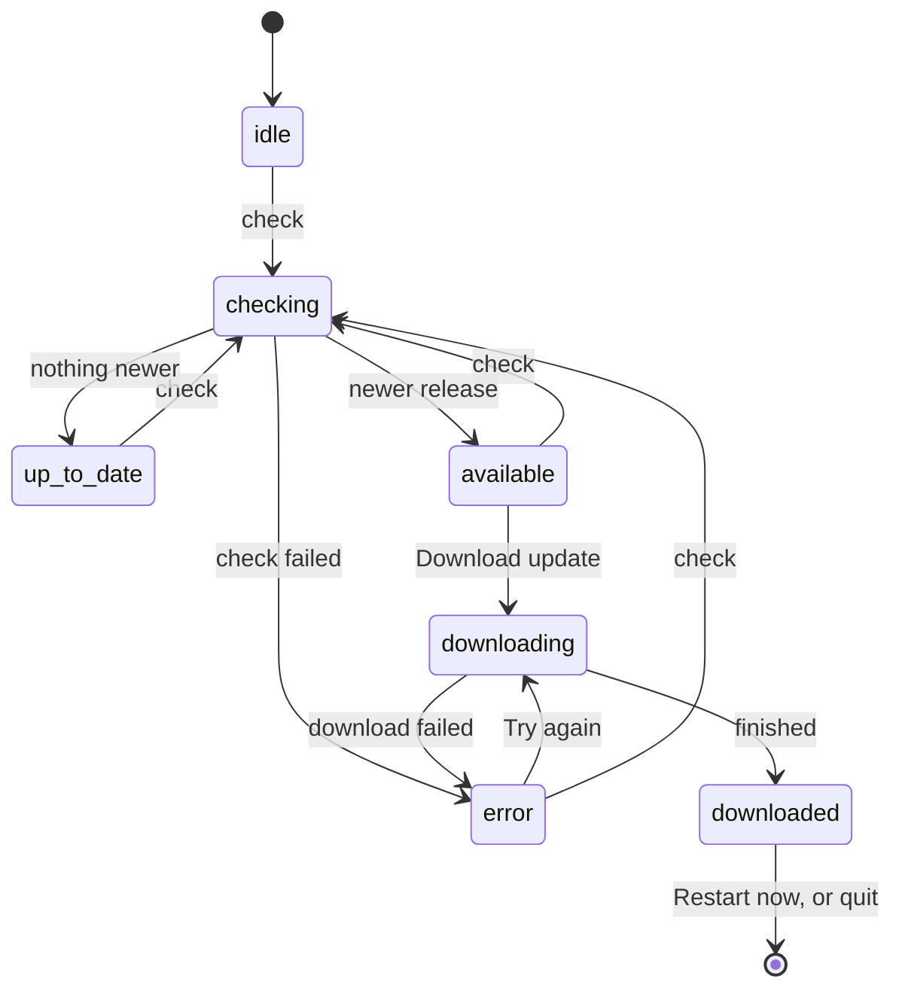

# Software updates

Omnidex can check GitHub Releases for a newer version. The check is **opt-in and off by default**, and it cannot install an update on macOS yet, because current macOS builds are not signed with a Developer ID. This page covers how the feature works and what has to exist before it is turned on for real.

Nothing contacts GitHub unless the user asks. A development build never checks.

## What triggers a request

| Trigger | Requests | Default |
|---|---|---|
| Press **Check for updates** (Settings → About, or the app menu) | One check | Always available in an installed build |
| Turn on **Check automatically** | A check now, then one at launch and every 4 hours | Off |
| Press **Download update** | The installer, plus `.blockmap` files on Windows | User-initiated only |
| Quit with a downloaded update | None; the installer runs locally (`autoInstallOnAppQuit`) | Automatic once downloaded |

A check requests the release feed and the update manifest (`latest.yml` on Windows, `latest-mac.yml` on macOS) from `github.com/Umbra-Lab/Omnidex`. The exact requests and what they carry are in `PRIVACY.md`, section 3. That file and the Settings → About copy (`renderer-react/src/features/updates/UpdatesCard.tsx`, `renderer-react/src/features/settings/tabs/AboutTab.tsx`) describe the same behavior and change together with the code.

## Where the code is

| File | Role |
|---|---|
| `electron/main/updater.ts` | The service: wires `electron-updater`, runs checks and downloads, owns the launch timer |
| `electron/main/updates/state.ts` | The state machine as a pure reducer, no Electron imports |
| `electron/main/updates/settings.ts` | The `updates.auto_check` preference and its default |
| `electron/main/trpc/routers/updates.ts` | The `updates` router: `state`, `check`, `download`, `install`, `setAutoCheck`, `openRelease` |
| `shared/types/updates.ts` | `UPDATE_STATE_CHANNEL`, the IPC channel state is pushed on |
| `electron/main/app-menu.ts` | The **Check for Updates…** menu item |
| `renderer-react/src/features/updates/` | `UpdateBanner`, `UpdatesCard`, the hooks, and the copy in `view.ts` |

## The state machine



`reduceUpdateStatus` in `state.ts` decides every transition. An event that does not fit the current phase returns the same object and publishes nothing, so a late `update-available` cannot overwrite a finished download and a second check cannot reset a download in flight.

`autoDownload` is off. A check finds a release and stops. The user starts the download, so an unsigned macOS build never downloads something it cannot install in the background.

## The preference

`updates.auto_check` is a row in `app_settings`, stored as the string `'true'` or `'false'`. Only the exact string `'true'` turns it on, so a hand-edited or legacy value fails closed.

The launch timer is armed in every installed build and re-reads the preference on each tick. Turning the switch off through any path, including the generic `settings.set` procedure, stops the next request.

To change the default, edit `UPDATE_DEFAULTS` in `updates/settings.ts`. That is a privacy change: update `PRIVACY.md`, `UpdatesCard.tsx` and `AboutTab.tsx` in the same commit.

## How the renderer stays current

The main process pushes the full state to the window on `UPDATE_STATE_CHANNEL` after every change (`forwardStateToWindow` in `updater.ts`). `UpdateBanner` is mounted once in `AppShell` and writes each push into the `updates.state` query cache, so the banner and the About tab read the same value through `useUpdateState`. The query also refetches on window focus, which repairs a push missed in the background.

```admonish warning title="This is an IPC event, not a tRPC subscription"
The banner was built as an IPC event when electron-trpc closed a frame's subscriptions on every hash-route change, which would have silenced a subscription opened at startup after the first click. A patch now stops that (see [IPC and the tRPC layer](ipc.md)), so a subscription would also work. The push design stays because it already fits: the main process pushes after every change and the renderer only listens.
```

The banner appears only for an update that needs a decision: found, downloading, ready, or a failed download. A failed *check* stays in Settings → About, because a background check that could not reach GitHub is not worth an interruption. **Later** dismisses the banner; the update installs on the next quit.

## What has to exist before updates are delivered for real

Until these hold, treat the check as a way to learn a release exists, not as a way to install it.

| Requirement | Why | Where it lives |
|---|---|---|
| A published GitHub Release, not a draft, with `latest.yml` and `latest-mac.yml` attached | The check reads the manifest from the latest release. With none, the UI says "No releases are published yet." | `pnpm release` and `pnpm release:mac` upload them; `build.publish` in `package.json` |
| macOS: a Developer ID Application certificate and notarization | `electron-updater` can only apply a macOS update whose signature chains to a Developer ID. Unsigned or ad-hoc builds fail the download with a signature error, which the banner reports | `docs/MACOS-BUILD.md`, "Signed + notarized release"; `CSC_LINK`, `CSC_KEY_PASSWORD`, `APPLE_ID`, `APPLE_APP_SPECIFIC_PASSWORD`, `APPLE_TEAM_ID` |
| macOS: both the `dmg` and the `zip` in the release | The `zip` is what the updater applies; the `dmg` is for first installs | `build.mac.target` in `package.json` |
| Windows: an Authenticode certificate | Without it SmartScreen warns on every installer. With it, electron-builder records the certificate's common name as `publisherName`, and `electron-updater` checks each downloaded installer against it (`win.verifyUpdateCodeSignature`, on by default). An unsigned installer is checked only against the sha512 in `latest.yml` | `docs/DEPLOYMENT.md`, "Code signing"; `WIN_CSC_LINK`, `WIN_CSC_KEY_PASSWORD` |
| A version that increases | The updater compares the release version to the running one | `version` in `package.json` |
| Disclosure that matches the code | The check contacts a third party | `PRIVACY.md` section 3, Settings → About |

Verify a macOS release before publishing it:

```bash
codesign --verify --deep --strict --verbose=2 Omnidex.app
```

```bash
spctl --assess --type execute --verbose=4 Omnidex.app
```

Then install the release on a clean machine and update from it to the next one. A green unit suite does not prove that path: the tests mock `electron-updater`.

## Changing the default to on

Do not do this until a signed and notarized macOS build and a signed Windows build have each updated in place from one published release to the next on a clean machine. Then the change is `UPDATE_DEFAULTS.autoCheck` plus the disclosure copy above. The macOS caveat lines in `UpdatesCard.tsx` and `PRIVACY.md` come out in the same commit.

## Tests

```bash
pnpm exec vitest run electron/main/updates electron/main/__tests__/updater.test.ts renderer-react/src/features/updates
```

```bash
pnpm build && pnpm test:electron tests/electron-updates.spec.ts
```

The Playwright spec runs the unpackaged build, so it proves the surrounding loop (the switch persists through the main process, the menu reaches the About tab, a development build says it cannot check, state pushed from the main process shows up after a route change) and cannot reach GitHub. Events, downloads, and failures are covered in `updater.test.ts` against a mocked `electron-updater`.

## Next steps

- [Package a release](../guides/package-a-release.md) for building and publishing the installers the updater reads
- [IPC and the tRPC layer](ipc.md) for why state arrives as an IPC event and not a subscription
- [tRPC API](../reference/trpc-api.md) for the `updates` procedures
